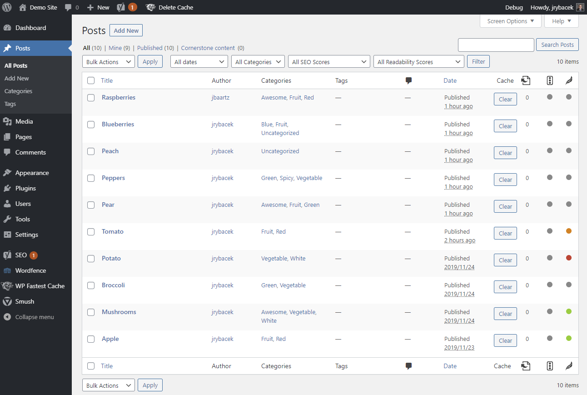
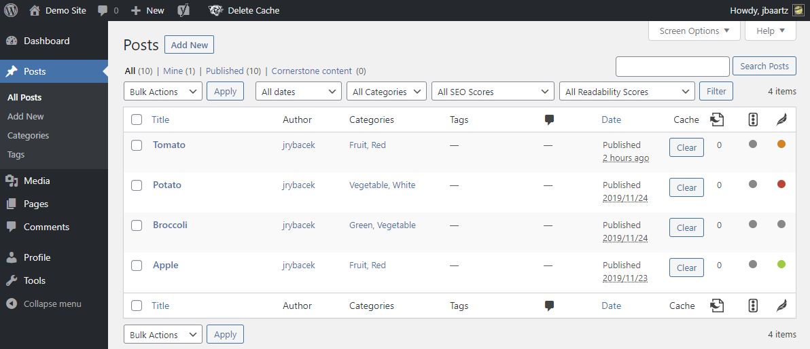
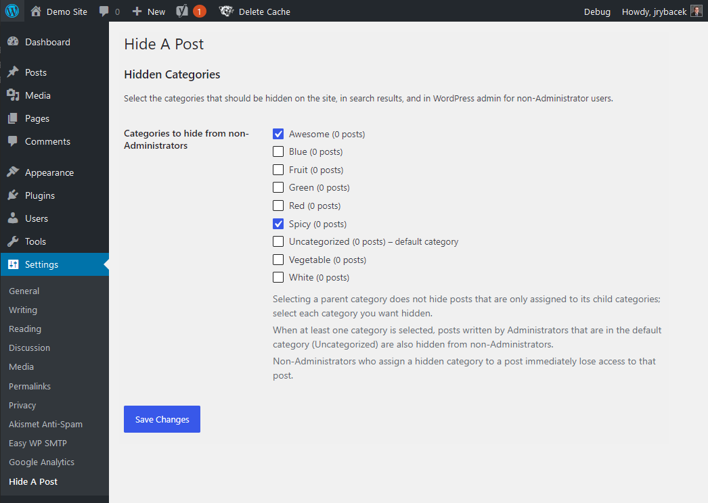

# Hide A Post

> A WordPress plugin that hides posts from non-Administrators on the site, in search, and in WordPress admin by category.

Hide A Post lets Administrators keep selected categories—as well as Uncategorized posts authored by Administrators—hidden from Editors and other non-Administrator users across the site, search results, and the WordPress admin post list.

## Table of Contents

- [Background](#background)
- [Install](#install)
- [Usage](#usage)
- [Screenshots](#screenshots)
- [Maintainers](#maintainers)
- [Contributing](#contributing)
- [License](#license)

## Background

This plugin was created for a tabletop gaming group using WordPress to collaborate on campaign content while letting the Dungeon Master keep certain "secrets" hidden from players—without needing to stack 15 different plugins to accomplish something simple.

## Install

### Requirements

- WordPress 5.0+

### Manual Installation

1. Download the plugin archive from the [GitHub repository](https://github.com/jrybacek/hide-a-post).
2. Extract the archive into your WordPress `wp-content/plugins/` directory (or upload the `.zip` file via **Plugins → Add New → Upload Plugin**).
3. Activate **Hide A Post** from the **Plugins** screen in WordPress admin.

## Usage

1. In WordPress admin, go to **Settings → Hide A Post**.
2. Enter one or more existing category names separated by commas (for example: `Awesome, Spicy`) and click **Save Changes**.

Once configured:

- Posts assigned to any configured hidden category are hidden from non-Administrators.
- Posts authored by an Administrator that still have the `Uncategorized` category are hidden from non-Administrators until recategorized.
- Administrators continue to see all posts.

### Example

With hidden categories set to `Awesome, Spicy`:

#### Posts Seen by Administrators

| Post | Author Role | Categories | Visibility for Editors |
| :--- | :--- | :--- | :--- |
| Tomato | Administrator | Fruit, Red | Visible |
| Potato | Administrator | Vegetable, White | Visible |
| Broccoli | Administrator | Vegetable, Green | Visible |
| Mushrooms | Administrator | Vegetable, White, Awesome | Hidden (`Awesome`) |
| Apple | Administrator | Fruit, Red | Visible |
| Pear | Administrator | Fruit, Green, Awesome | Hidden (`Awesome`) |
| Peppers | Administrator | Vegetable, Green, Spicy | Hidden (`Spicy`) |
| Peach | Administrator | Uncategorized | Hidden (Admin + `Uncategorized`) |
| Blueberries | Administrator | Fruit, Blue, Uncategorized | Hidden (Admin + `Uncategorized`) |
| Raspberries | Editor | Fruit, Red, Awesome | Hidden (`Awesome`) |

#### Posts Seen by Editors

- **Tomato** — Fruit, Red
- **Potato** — Vegetable, White
- **Broccoli** — Vegetable, Green
- **Apple** — Fruit, Red

## Screenshots

1. **Posts as an Administrator**

   

2. **Posts as an Editor**

   

3. **Hide A Post Settings Page**

   

## Maintainers

[@jrybacek](https://github.com/jrybacek)

## Contributing

Issues and pull requests are welcome!

- **Commits:** This project uses combined [Gitmoji](https://gitmoji.dev/) and [Conventional Commits](https://www.conventionalcommits.org/en/v1.0.0/) (`<gitmoji> <type>(<scope>): <description>`). See [CONTRIBUTING.md](CONTRIBUTING.md) for the full emoji mapping, examples, and local git hook setup.
- **Changelog:** Release notes in [CHANGELOG.md](CHANGELOG.md) are generated with [git-cliff](https://git-cliff.org/) using [cliff.toml](cliff.toml).
- **README:** If editing this README, please conform to the [standard-readme](https://github.com/richardlitt/standard-readme) specification.

## License

[GPL-2.0](LICENSE) © Joe Rybacek
